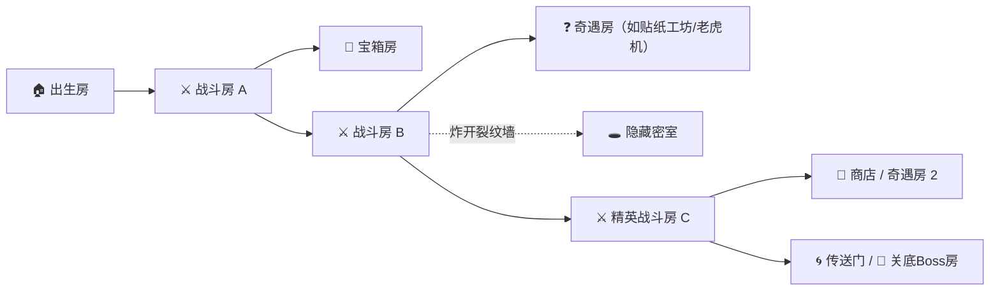

# 《魔改骑士》地牢奇遇房间与隐藏彩蛋全案

> **设计目标**：告别传统地牢“清怪→开箱→进门”的单调循环！通过**高密度奇遇房（每层必出 1~2 间）、可炸开的裂纹隐藏密室、NPC 趣味互动与每日挑战因子**，确保玩家每 2 分钟就能遇到一次“笑出声、赌一把、或彻底改写本局构筑”的惊喜节点。

---

## 1. 单层地牢拓扑与奇遇房生成规则

### 1.1 地图生成机制（房间网格拓扑）
- 每层在 `5×5` 网格上以主路 + 分支方式生成 `6 ~ 10` 个相连房间（房间之间由带闸门的像素走廊连接）。
- 房间功能类型与小地图图标清晰区分：
  - 🏠 **出生房**（固定 1 间，安全区）
  - ⚔️ **战斗房**（2 ~ 4 间，进入后锁门刷 2~3 波怪，全清后开门并给金币/蓝球奖励）
  - 🎁 **常规宝箱房**（每层固定 1 间，刷武器箱或贴纸礼盒，有极小概率伪装成**宝箱怪**！）
  - ❓ **奇遇房 / 功能房**（每层固定 **1~2 间**！从下方 16 种奇遇池按权重抽取，本局尽量不连续重复）
  - 🕳️ **隐藏裂纹密室**（每层 `45%` 概率生成 1 间，小地图默认**不显示**，需用爆炸/重击/激光或宠物提示发现）
  - 🌀 **传送门房 / Boss 房**（第 1~4 层为普通传送门房，第 5 层为大尺寸关底 Boss 房）

---

## 2. 十六种高密度奇遇房间详案

> 所有奇遇房都带有**像素 NPC 气泡台词**，兼具实用策略与搞怪演出！

### A. 魔改与装备强化类（4 种）

#### 1. 🏷️ 贴纸魔改工坊（地牢核心高频房）
- **NPC**：戴着放大镜的矮人贴纸匠「阿胶」—— *“只要钱到位，给马桶搋子贴核弹我都干！”*
- **提供三项服务**：
  1. **直购贴纸**：货架展示 3 张随机魔改贴纸（绿 30 金 / 蓝 50 金 / 紫 80 金 / 橙 120 金），支持花 15 金刷新一次。
  2. **无损撕贴转移**（35 金）：将副武器或主武器上的任意 1 张贴纸无损撕下来，转贴到另一把武器上。
  3. **强行扩槽打孔**（90 金，每局限 1 次）：给当前手持武器强行钻出 `+1` 贴纸槽位（不超过 4 槽上限）。

#### 2. 🔥 神秘重铸铁匠铺
- **NPC**：挥舞巨锤的肌肉猫头鹰铁匠 —— *“咣咣两锤，不是变神兵，就是变废铁！”*
- **交互机制**：
  - **常规强化**（40 金）：给当前武器永久 `+15% 伤害` 或 `随机附加 1 张随机绿/蓝贴纸`。
  - **盲盒重铸**（25 金）：把手中一把不想要的武器丢进熔炉，随机重铸成**同品质或高一品质**的全新脑洞武器（30% 概率升品质！）。

#### 3. ♻️ 神奇垃圾回收机（以旧换新）
- **设施外观**：一台张着大嘴、眼睛会转圈的铁皮像素机器人。
- **交互机制**：
  - 可以把地上或手里不要的武器塞进去喂它，根据品质吐出**金币 + 锻造材料 + 小概率直接吐出 1 张贴纸**；
  - **隐藏彩蛋**：如果一次性连续塞进 3 把武器，机器会打个响亮的嗝，吐出一件**史诗/传说品质**武器或**稀有蓝图**！

#### 4. 🗿 远古搞笑雕像房
- **设施**：随机刷新 6 种造型奇葩的像素石像（如“骑士雕像”“圣骑士雕像”“狂战士雕像”“刺客雕像”“牧师雕像”“财神猫雕像”）。
- **机制**：花 `30~50 金币` 供奉，获得对应**雕像祝福（每次按英雄技能键时额外触发一次特效）**：
  - *狂战士雕像*：放技能后 5 秒内子弹巨化且伤害 +3（配合贴纸巨化屏幕要炸了！）；
  - *圣骑士雕像*：放技能立刻获得一层抵挡 1 次伤害的金色护盾罩；
  - *财神猫雕像*：放技能时向四周撒出一圈追踪金元宝攻击敌人！

---

### B. 赌狗博弈与高风险奇遇类（6 种 —— 节目效果爆炸！）

#### 5. 🎰 命运像素老虎机
- **台词**：“*再摇一次！下一把绝对出橙武！（地牢反诈中心提示：量力而行）*”
- **成本**：每次 `15 金币`（每次摇完价格 +5 金，最多摇 6 次）。
- **概率分布**：
  - `25%` 谢谢惠顾（吐出一团黑烟 + 一句嘲讽气泡，或者掉 1 块钱找零）
  - `20%` 爆炸惊喜（吐出一颗 1.5 秒后引爆的定时炸弹——玩家需要走位躲开！）
  - `25%` 小奖（回血药水 / 大蓝瓶 / 随机绿蓝贴纸 / 30~50 金币返现）
  - `20%` 大奖（随机紫/橙色脑洞武器 或 紫色魔改贴纸）
  - `10%` **头奖 JACKPOT！**（拉霸机发出欢呼音乐，喷射金币雨 + 掉出 1 把传说武器 + 1 张橙色贴纸，随后机器冒烟报废）

#### 6. 😈 恶魔诅咒祭坛（用血换神装）
- **NPC**：戴着蝴蝶结的礼貌小恶魔 —— *“亲，用 1 点生命上限换一张橙色【武器影分身贴】，血赚不亏哦~”*
- **机制**：祭坛摆出 **3 件极品道具**（橙色贴纸、传说武器、或强力隐藏天赋），不收金币，而是标价 **`-1 生命上限`** 或 **`-2 生命上限`**（保底至少保留 1 点生命上限防止自杀）。
- **衍生彩蛋**：如果你把 3 件全买空，小恶魔会感动地送你一个“恶魔大客户”勋章（本局暴击率 +8%）。

#### 7. ⛲ 神奇许愿池
- **交互**：每次投入 `10 金币` 许愿（最多 10 次，越投概率越累计上升）。
- **趣味结果**：
  - 大多数时候冒出一串爱心或气泡；
  - 概率吐出：**满地小药水、随机魔法种子、稀有蓝图、搞笑武器「黄金平底锅」、或者召唤出一只友军小精灵跟着你打 1 层**；
  - `5%` 搞笑翻车：水面浮出一只生气的巨型青蛙怪，打死它必掉 40 金币 + 1 张贴纸！

#### 8. 📦 双倍赌命宝箱房（真假宝箱二选一）
- **场景**：房间正中央并排放着**一红一蓝两个发光大宝箱**，中间插着牌子：*“选对拿双倍，选错……它咬人！”*
- **机制**：
  - 打开其中一个宝箱时，另一个会立刻消失或现形：
  - `60%` 直接开出**双倍奖励**（武器 + 贴纸 + 大量金币）；
  - `40%` 宝箱突然长出獠牙和大腿变成**「精英宝箱怪」**疯狂追咬玩家！但只要玩家成功击杀精英宝箱怪，**不仅拿到原本宝箱的奖励，还额外多掉 1 张高级贴纸**（风险越大收益越高！）。

#### 9. 🛒 黑心奸商的移动摊位（支持“硬抢”！）
- **NPC**：蒙面地精商人，摆卖 4 件商品（血瓶、蓝瓶、随机武器、贴纸或材料）。
- **正常买**：明码标价，童叟无欺（略贵）。
- **🔥 独家节目效果 —— 你可以攻击奸商抢劫！**：
  - 如果玩家对着奸商连续开火超过 10 点伤害，奸商就会怒吼：“*敢白嫖老子？！保安！*” 瞬间锁门掏出**双持加特林**化身强力精英 Boss，且后续层数所有黑商都会对你涨价 50% 并挂通缉令！
  - 但如果你成功干翻武装奸商，**摊位上全部 4 件商品免费白嫖**，还额外掉落奸商专属装备！

#### 10. 🎲 命运大转盘（免费整活局内因子）
- **场景**：墙上一个闪烁霓虹灯的巨型像素转盘，免费转 1 次。
- **随机给本层附加一个夸张临时效果**：
  - **【全员大头模式】**：所有怪物头变大 2 倍，暴击率翻倍！
  - **【金币狂潮】**：本层怪物死亡爆炸喷出 3 倍金币，但怪物移速 +20%。
  - **【武器疯狂互换】**：每过 20 秒随机把你手里的武器临时变成图鉴里的任意一把满贴纸神兵体验（离开本层恢复原武器）！
  - **【低重力蹦迪】**：击退力度 ×3，怪物一被打就满房间弹来弹去。

---

### C. 伙伴、增益与剧情互动类（6 种）

#### 11. 🍺 地牢酒馆（雇佣奇葩随从）
- **NPC**：可花费 `40~65 金币` 雇佣一名带着自己性格台词的像素佣兵陪你闯关（跨层保留，阵亡后每过 1 层自动复活）：
  - **「暴躁大厨」**：挥舞菜刀砍子弹，偶尔扔出平底锅砸晕敌人；
  - **「近视弓箭手」**：射速极快但准头感人，自带“我发誓我瞄准了”台词，可把地上不需要的武器**送给佣兵装备**（佣兵拿你的废旧武器一起打！）；
  - **「自爆狂哥布林」**：叛变加入我方的炸弹兵，专炸怪堆和裂纹墙；
  - **「皇家实习法师」**：会释放冰霜环保护玩家。

#### 12. 💊 怪医诊所
- **NPC**：戴着鸟嘴面具的游医 —— *“喝下这瓶发光的紫色液体，包治百病（副作用不负责）。”*
- **服务**：
  - 稳妥治疗（25 金）：回满全部血量；
  - **实验药剂**（20 金，限 1 次）：随机永久提升一项本局上限（`+1 生命上限` / `+1 护盾上限` / `+40 蓝量上限` / `+15% 移速`），有 15% 概率让你变成“迷你小人”（体型变小 30%，碰撞箱变小超好躲弹幕！）。

#### 13. ⚔️ 竞技场挑战房（波次试炼）
- **机制**：房间中央插着一把发光挑战旗，玩家可**自由选择是否拔旗开打**。
- **规则**：拔旗后连续迎战 3 波高密度精英怪，撑过去立刻开启中央的**传说级黄金大宝箱**（必出紫/橙武器 + 紫/橙贴纸）。

#### 14. 🔮 魔法导师的附魔台
- **机制**：可消耗 1 次互动机会，对当前已有的一张局内天赋进行**「进阶强化」**（例如把“火盾”升级为“烈焰反伤盾”，把“霰弹增多”升级为“超级霰弹+3”），极大增加 Build 深度。

#### 15. 🧙‍♂️ 流浪武器收藏家（以物换物）
- **NPC**：背着巨大麻袋的老头 —— *“小子，你手里那把绿武器看着不错，跟我换我袋子里这把神秘武器不？”*
- **机制**：用你身上任意一把武器交换他手里看不清名字的**“神秘问号武器”**——保底不低于原品质，有 40% 概率换到**高两档品质的史诗/传说神兵**，也有 15% 概率换到自带 3 张神级贴纸的白板折凳！

#### 16. 🛸 异次元传送试炼室（隐藏捷径/彩蛋房）
- **稀有刷新（每局最多遇到 1 次）**：出现一个闪烁蓝紫故障光的传送门，跳进去进入一个 30 秒倒计时的**「金币与贴纸雨小游戏关」**（类似打砖块/打满屋子乱跑的黄金哥布林），打多少拿多少，时间一到直接送回地牢，超解压！

---

## 3. 隐藏裂纹密室与彩蛋系统

### 3.1 如何发现与进入隐藏密室
- 每层有 `45%` 概率在某个普通战斗房或奇遇房的墙壁上生成一段**带有细微十字裂纹的像素墙面**。
- **提示手段**：
  - 肉眼仔细观察可看到轻微像素裂缝；
  - 携带宠物**【机械鸭「嘎嘎号」】**靠近时会发出急促“嘎嘎！”并头顶冒感叹号；
  - 携带天赋**【奇遇嗅觉】**时裂缝会泛出微弱金光。
- **破墙方式**：使用**炸药桶爆炸、火箭筒/迫击炮/陨石爆炸、蓄力满激光、40米大长刀重劈、或任意带【爆裂辣椒/核能辐射】贴纸的武器**攻击裂缝，墙面轰然炸开，露出隐藏密室！

### 3.2 隐藏密室内的 4 种惊喜内容
1. **贴纸印刷厂秘库**：直接白捡 `2 张紫/橙色魔改贴纸` + 1 台免费撕贴机！
2. **开发者休息室（致敬彩蛋！）**：里面坐着正在敲键盘写代码的像素“程序猿”和“画师”，对话会吐槽加班，把房间里的“神秘咖啡机”打破可掉出一把满贴纸彩蛋武器或大量蓝币。
3. **黄金史莱姆巢穴**：一屋子不会还手的黄金肥史莱姆，疯狂暴打可爆出 `80~150 金币` 和一堆锻造宝石！
4. **隐藏彩蛋 Boss 传送门**（仅在第 2 或第 3 大关低概率刷出）：进入挑战**隐藏彩蛋 Boss「物业经理·大鹅王」**，击败必掉限定红武与专属客厅奖杯！

---

## 4. 每日挑战因子系统（客厅看板接取）

每天自动按本地日期种子（离线也能每天变！）生成一套 **4 项组合因子（2 个正面爽点 + 2 个整活/挑战点）**，完成当日挑战通关额外奖励 `+1,500 蓝币 + 2 张稀有蓝图/种子`！

### 因子池示例（12 项）

| 性质 | 因子名 | 局内效果 |
| :---: | :--- | :--- |
| 🟢爽点 | **贴纸大甩卖** | 每层额外多刷 1 间贴纸工坊，且所有武器默认 `+1 贴纸槽` |
| 🟢爽点 | **无限蓝量** | 能量回复速度 ×5，全武器几乎 0 耗蓝畅爽狂射 |
| 🟢爽点 | **武器巨无霸** | 所有武器和子弹尺寸默认放大 1.5 倍，伤害 +25% |
| 🟢爽点 | **技能冷却减半** | 英雄主动技能 CD 缩短 50%，双持/炮台/居合停不下来 |
| 🟢爽点 | **奇遇大爆发** | 每层固定多生成 2 个奇遇房，老虎机免费摇 3 次 |
| 🟢爽点 | **暴击即爆炸** | 玩家每次触发暴击都会在敌人脚下引发微型范围爆炸 |
| 🔴挑战 | **双倍 Boss 房** | 每大关第 5 层同时刷出 **2 只缩水版 Boss** 联手围攻！（奖励也翻倍） |
| 🔴挑战 | **玻璃大炮** | 玩家和所有怪物伤害翻倍，护盾上限减半，极度刺激 |
| 🔴挑战 | **手气抽奖局** | 每进入新的一层，手里武器强制重新随机变换为同品质脑洞武器（但保留所有贴纸！） |
| 🔴挑战 | **怪物分裂狂潮** | 普通小怪被击杀时有 35% 概率分裂成 2 只迷你小怪 |
| 🔴挑战 | **近战大师赛** | 本局只会掉落近战武器和无厘头奇物（但贴纸正常掉，逼你用咸鱼射激光！） |
| 🔴挑战 | **极速狂飙** | 敌我双方移速与子弹速度全部提升 35%，快节奏弹幕狂欢 |
