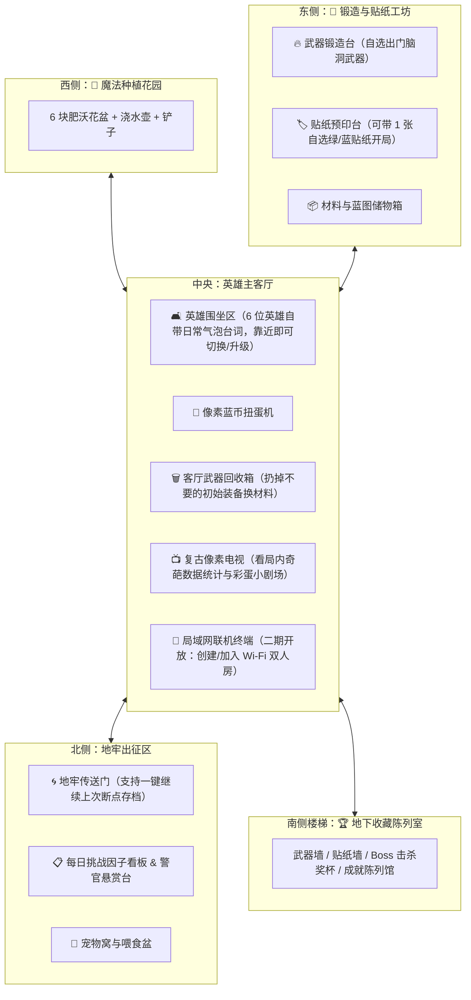

# 《魔改骑士》豪华像素客厅与局外养成系统全案

> **设计精髓**：《元气骑士》最让人有归属感的，就是那个热闹温馨、所有英雄围坐聊天打牌的**“魔法客厅”**！本作打造**全功能可自由走动的豪华像素客厅**——出征前可以逛花园收菜、去锻造台造一把出门神兵、给武器提前贴一张开局贴纸、摇两把扭蛋机、揭下每日挑战悬赏令、下地下室欣赏金框图鉴，再带着心爱的宠物昂首步入地牢传送门！

---

## 1. 豪华客厅空间蓝图（三区连通）

客厅由**主客厅（中央）**、**魔法花园（左侧大门进入）**、**锻造与工坊区（右侧大门进入）**以及**地下收藏室（下方楼梯进入）**无缝拼接组成，支持摇杆自由走动 + 点击快捷传送图标一键直达（兼顾沉浸感与效率）。

---

## 2. 客厅全部核心设施详解

### 2.1 英雄选人区与生动日常互动
- 6 位未选中的英雄会坐在客厅的木桌、沙发、地毯上**各自做像素小动画**（比如铁桶骑士在擦水桶、贴纸工匠在狂贴便利贴、游侠喵在玩毛线球、圣光牧师在趴着打瞌睡）。
- 走近任意英雄按互动键弹出简洁面板：**「出战」「使用蓝币升级」「查看技能演示与皮肤」**。
- **免费皮肤解锁**：每位英雄额外规划 2 套纯靠成就解锁的搞笑像素皮肤（如铁桶骑士的「黄金泡面桶皮肤」、游侠喵的「墨镜赛博猫皮肤」），完全零氪。

### 2.2 🔨 武器锻造台与贴纸预印台（东区）
- **武器蓝图解锁规则**：
  - 在地牢中累计拾取过同一把武器达到 **8 次**（普通/精良只需 **5 次**，红武需击败对应 Boss 掉落专属蓝图 1 次），即可在锻造台永久解锁该武器的自选锻造权限！
- **材料体系（精简到 6 种，绝不繁琐）**：
  1. `铁矿石`（机械怪、木箱、石块掉落）
  2. `魔法碎片`（法师怪、奇遇房、分解法杖掉落）
  3. `木材`（哥布林、破坏木箱、花园收菜掉落）
  4. `怪奇零件`（精英怪、垃圾回收机掉落，用于造无厘头奇物）
  5. `荧光胶水`（贴纸工坊、Boss 掉落，用于制作开局贴纸）
  6. `核心晶石`（每大关 Boss 必掉，用于锻造橙武/红武）
- **贴纸预印台（本作独家爽点！）**：
  - 玩家收集过某张魔改贴纸达到 3 次后，可在出门前花费少量`荧光胶水`，**预先给初始武器贴上 1 张绿色或蓝色贴纸带进 1-1**（例如出门直接给咸鱼贴上【弹弹乐】或【爆裂辣椒】），开局就爽！

### 2.3 🌱 魔法种植花园（西区）
- 共 **6 块土地**（初始免费开放 3 块，另外 3 块通过蓝币或通关成就永久解锁）。
- **种植规则**：种下在地牢/Boss/许愿池获得的种子，**浇一次水**，经过 **1 个自然日** 或 **完成 2 局地牢冒险**（双重成熟机制，拒绝逼迫等现实时间！）即可收获。
- **8 种核心功能植物全案**：

| 植物名 | 稀有度 | 类型 | 成熟采摘效果 |
| :--- | :---: | :---: | :--- |
| **1. 蓝币发财树** | 🟢绿 | 一次性 | 收获 `250 ~ 400 蓝币` |
| **2. 铁矿仙人掌** | 🟢绿 | 一次性 | 收获 `6~10 铁矿石 + 怪奇零件` |
| **3. 烈焰辣椒树** | 🔵蓝 | **多年生（每天可摘）** | 采摘后本局免费获得**【火盾（火焰免疫）】**天赋！ |
| **4. 曼德拉毒草** | 🔵蓝 | **多年生** | 采摘后本局免费获得**【毒盾（毒素免疫）】**天赋！ |
| **5. 极寒雪莲** | 🔵蓝 | **多年生** | 采摘后本局免费获得**【冰盾（冰冻免疫）】**天赋！ |
| **6. 贴纸藤蔓** | 🟣紫 | **多年生** | 采摘后直接掉落 **1 张随机蓝/紫色魔改贴纸**带进地牢！ |
| **7. 萝卜神树** | 🔵蓝 | 一次性 | 拔出来直接获得一把自带随机贴纸的**「加特林大萝卜」**带出门！ |
| **8. 幸运四叶草** | 🟠橙 | 一次性 | 本局获得隐藏祝福**【欧皇降临】**（宝箱与奇遇稀有度大幅提升） |

> **贴心防肝设计**：多年生植物种下一次后，只需每天/每两局顺手浇一下水即可反复白嫖天赋进本，不用反复刷种子！

### 2.4 🎰 像素蓝币扭蛋机（主客厅）
- **单抽价格**：`200 蓝币`（每日限抽 20 次，防止无脑点到手酸；无任何氪金币）。
- **奖池内容**：
  - `35%` 各种锻造材料包 & 荧光胶水
  - `25%` 魔法花园稀有种子
  - `20%` **随机出门武器**（直接掉在客厅地上，捡起来就能带进 1-1 开荒！）
  - `12%` 稀有武器蓝图碎片 / 贴纸图鉴解锁卡
  - `8%` **隐藏炸弹彩蛋**（扭蛋冒烟炸开把客厅地板熏黑一小块，并返还 250 蓝币安慰奖，纯纯元气味幽默！）
- **保底机制**：每 10 抽必出至少 1 个稀有种子、蓝图或紫色以上出门武器。

### 2.5 📋 每日挑战看板与警官悬赏
- **每日挑战因子**：展示当天生成的 4 项随机因子（2 爽 + 2 挑战），可免费接取，也可花 200 蓝币手动重随一次（每日限 2 次）。
- **悬赏通缉令**：每天刷新 2 个轻松小目标（如“用带有【下蛋母鸡贴】的武器击杀 20 只怪”“在奇遇房赢得一次老虎机奖励”“击败雪山大猿王”），完成即领 `400~800 蓝币` 与材料箱，引导玩家尝试各种新奇玩法。

### 2.6 🏆 地下收藏陈列室（收集癖天堂）
走下客厅南侧的石梯，进入类似博物馆的炫酷像素地下室，按区域直观展示玩家所有成就：
1. **36 把脑洞武器展墙**：未捡过显示剪影，捡过点亮彩色图标，**带着该武器通关 3-5 后自动镀上炫酷金框！**
2. **24 张魔改贴纸收藏墙**：记录每张贴纸的历史使用次数与“最离谱魔改配方历史榜”。
3. **Boss 奖杯与击杀统计馆**：击败 6 大关底 Boss 和隐藏大鹅王后，底座立起对应的金色像素雕像，点击可查看历史战绩与最快击杀纪录。
4. **整活成就系统（30+ 搞笑成就）**：
   - *《咸鱼翻身》*：用贴满 3 张贴纸的「超级咸鱼」通关 3-5（奖励：专属称号 + 1,000 蓝币）
   - *《反客为主》*：在地牢里抢劫黑心奸商并成功干翻他（奖励：怪奇零件 ×15）
   - *《养鸡场场长》*：同一房间内同时存在超过 12 只暴走小鸡（奖励：贴纸藤蔓种子 ×1）
   - *《欧皇本皇》*：在老虎机摇出一次 JACKPOT 头奖（奖励：1,200 蓝币）
   - *《物业克星》*：发现隐藏密室并击败大鹅王（奖励：大鹅奖杯 + 限定武器解锁）

---

## 3. 局外经济循环与防肝平衡表

作为纯单机、无内购无广告的游戏，经济节奏的核心目标是：**“玩 1 局就有明显收获，玩 10~15 小时能解锁绝大部分核心角色与客厅玩法，后续靠脑洞组合、金框图鉴、每日因子和无尽深渊持续保鲜。”**

| 游玩行为 | 预期蓝币产出 | 附带成长产出 |
| :--- | :---: | :--- |
| 倒在第一大关（1-3~1-5，约 6 分钟） | `300 ~ 550` | 少量材料、武器图鉴进度 |
| 倒在第二大关（2-3~2-5，约 14 分钟） | `750 ~ 1,100` | 丰富材料、1~2 颗种子、蓝图进度 |
| **完整通关 3-5（约 22 分钟）** | **`1,600 ~ 2,200`** | 大量核心晶石 + 稀有种子 + 武器金框 |
| 每日悬赏 + 每日挑战通关 | 额外 `+1,500 ~ 2,000` | 稀有蓝图 / 贴纸种子 |
| 成就解锁里程碑 | 单项 `500 ~ 1,500` | 免费皮肤 / 客厅装饰 / 土地解锁 |

> 换算一下：**只需玩 2 局完整流程或 3~4 局探索**，就能买下一位全新英雄或把现有英雄大幅升阶，正反馈节奏极其明快爽快！
