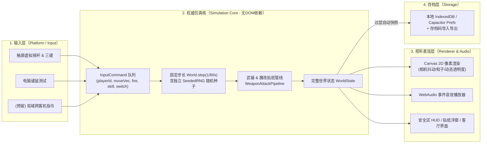

# 《魔改骑士》技术架构、视听规范与开发路线图

> **定位**：本章节为后续真正落地的工程蓝图。兼顾**“安卓手机 APK 流畅 60fps 离线运行”**、**“Windows 电脑浏览器秒开调试”**、**“魔改贴纸高扩展性”**以及**“未来无缝扩展 Wi-Fi 局域网双人联机”**四大核心工程目标。

---

## 1. 技术栈选型（AI 为你优选的最佳平衡方案）

| 层级 | 推荐选型 | 选择理由 |
| :--- | :--- | :--- |
| **开发语言 & 构建** | **TypeScript + Vite** | 强类型保护武器/贴纸/存档数据契约，热更新毫秒级，开发调试极其丝滑 |
| **核心引擎架构** | **自研轻量仿真核（ECS-lite / 固定时间步长 `60Hz`）** | 完全不绑定 DOM 或渲染框架，逻辑纯 JS/TS 运行，既极易单测又天然支持后续局域网联机 |
| **像素画面渲染** | **HTML5 Canvas 2D（离屏精灵图集 + 像素锐化缩放）** | 2D 像素游戏 Canvas 2D 在安卓 WebView 下稳定性与性能极佳，无需沉重 WebGL 上下文兼容坑，轻松跑满 60fps |
| **HUD 与客厅 UI** | **轻量 HTML/CSS 像素叠加层（或 Preact）** | 虚拟摇杆、背包、贴纸面板、锻造台、图鉴墙用 CSS 像素风 UI 排版效率极高，完美适配各种手机挖孔屏/圆角安全区 |
| **音效与配乐** | **WebAudio API 8-bit/16-bit 合成器 + 轻量音频缓存** | 零版权风险、包体极小（APK 体积可控制在 `15MB` 以内），随时动态生成清脆像素枪声、咸鱼拍打声与 Chiptune BGM |
| **安卓 App 打包** | **Capacitor（官方 Android 工程封装）** | 一条命令把 Web 产物同步进原生 Android 壳，自动锁定横屏、沉浸式隐藏导航栏、支持原生震动反馈与本地持久化存储，生成标准 `.apk` 直接装手机 |

---

## 2. 逻辑/表现解耦架构（预留局域网联机接口）

为了避免“先写死单机、以后加联机必须推倒重写”，系统严格划分为 **四层单向数据流**：



### 2.1 局域网双人联机（二期）无缝接入契约
只要一期开发严格遵守以下 4 条代码纪律，二期加 Wi-Fi 局域网联机只需新增网络传输模块即可：
1. **多玩家数组化**：从第一行代码起，仿真核内用 `players: Map<PlayerId, PlayerState>` 存储玩家（单机时只有 `P1`），切忌写死单例 `globalPlayer`。
2. **输入全指令化**：任何操作（移动、开火、放技能、切枪、贴贴纸、买东西）都封装为纯 JSON 结构 `InputCommand`，仿真核只消费指令，不直接读触屏/键盘事件。
3. **可复现随机数（Seeded PRNG）**：地图生成、老虎机、暴击、随机贴纸统一使用 `world.rng.next()`，禁止散落原生 `Math.random()`。
4. **主机权威（Host-Client）同步模型**：未来联机时，房主手机运行完整 `Simulation Core`（Host），好友手机通过同一 Wi-Fi 下的轻量局域网 WebSocket / Capacitor 局域网插件发送 `InputCommand` 并接收精简 `DeltaSnapshot` 渲染画面，开发成本最低且最抗手机弱网抖动！

---

## 3. 核心系统数据驱动设计（武器 × 贴纸管线）

所有 36 把武器和 24 张贴纸均采用**配置表 + 钩子函数（Pipeline Hooks）**实现，新增一把武器或一张贴纸几乎无需修改主战斗循环：

```typescript
// 伪代码结构示意：一次攻击如何流经武器与贴纸魔改管线
interface AttackContext {
  ownerId: string;
  weaponDef: WeaponDef;
  stickers: StickerId[];
  damage: number;
  manaCost: number;
  critChance: number;
  projectileCount: number;     // 初始弹道数（贴纸可叠加）
  spreadAngle: number;         // 散布角
  scale: number;               // 尺寸倍率（超级巨化贴修改）
  mode: 'melee' | 'bullet' | 'laser' | 'lob';
  behaviors: ProjectileBehavior[]; // 追踪、弹跳、回旋、穿透、落点产鸡等
  elements: ElementTag[];          // 冰、火、雷、毒、核爆
}

// 统一执行顺序（保证所有组合可预测且不冲突）：
// 1. 武器基础属性填充 AttackContext
// 2. 依次运行每张贴纸的 onBuildContext(ctx)（修改数值、蓝耗、弹道数、形态转换）
// 3. 应用英雄被动 & 局内天赋 & 雕像加成
// 4. 若为近战武器但被贴纸附加了弹道/激光效果：保留近战消弹框 + 同时生成对应剑气/激光弹体！
// 5. 发射实体进入 World.projectiles（受对象池上限 180 与动态透明度保护）
// 6. 命中/击杀时依次触发贴纸的 onHit(target) / onKill(target)（连锁闪电、变鸭子、产蛋、撒币等）
```

---

## 4. 像素美术、屏幕适配与手机触控规范

### 4.1 分辨率与视觉比例
- **基础逻辑画布**：`480 × 270`（标准 16:9 像素基准；对 20:9 等现代安卓全面屏自动向左右延伸视野至约 `560 × 270`，绝不拉伸变形、绝不留大黑边！）。
- **像素瓦片尺寸**：`16 × 16 px`（角色约 `16 × 20 px`，大 Boss 约 `48 × 48` ~ `64 × 64 px`）。
- **锐利像素渲染**：Canvas 全局设置 `ctx.imageSmoothingEnabled = false`，相机坐标渲染前对齐物理像素网格，避免像素抖动（Pixel Shimmering）。
- **前期资产策略（纯代码程序化像素图集 + 可替换 PNG 接口）**：
  - 开发初期可用内置**像素矩阵画板脚本**一键生成风格统一、带清晰 1px 黑色描边的全套角色/怪物/武器/地砖像素图集；
  - 图集加载层同时支持无缝替换为外部手绘 `.png` 精灵表，方便后期精细打磨美术！

### 4.2 手机触控体验硬标准
- **强制横屏 + 沉浸全屏**：Android Manifest 锁定 `sensorLandscape`（支持左右翻转横屏，避开充电线插口方向），隐藏系统状态栏和底部导航条。
- **刘海/挖孔屏避让**：所有 HUD 血条、小地图与按键遵循 `env(safe-area-inset-*)` 安全边距，绝不被屏幕圆角遮挡。
- **右手三键人体工学热区**：
  - 攻击/互动键半径 `40dp`（大主圆，右下黄金拇指位）；
  - 技能键与切枪键半径 `28dp`，呈扇形环绕在攻击键左上与正上方，间距 ≥ `14dp` 防误触；
  - 左侧虚拟摇杆支持**动态跟随落点**（左半屏任意处按下即刻设为摇杆中心），松手淡隐不遮挡弹幕视野。

---

## 5. 存档结构与防丢档设计

游戏采用**两套独立本地持久化档案**（同时支持一键生成/导入 Base64 存档备份码，换手机或重装 APK 不丢档）：

1. **永久客厅档（`meta_save.json`）**：
   - 蓝币余额、6 种材料数量、种子与花园 6 块地的种植/成熟时间戳；
   - 6 位英雄解锁状态与 Lv.1~Lv.7 等级、宠物解锁与亲密度；
   - 武器拾取计数 & 蓝图解锁表 & 金框通关记录、贴纸发现记录、Boss 击杀统计、成就进度、设置项（音量/震动开关/摇杆大小）。
2. **局中断点续玩档（`run_checkpoint.json`）**：
   - 仅在每进入新的一层（1-1 ~ 3-5 过门瞬间）覆盖写入：
   - 记录当前层数、生态、随机种子、角色血/盾/蓝、金币、已持武器及完整贴纸数组、已选天赋列表、佣兵状态、每日因子与本层已重开次数（限 1 次）。

---

## 6. 分期开发路线图（Roadmap）

当你后续决定启动编码时，建议按以下 **4 个清晰里程碑** 推进，确保每一步都有**立刻能玩、能测、能装手机**的阶段成果：

### 🚀 阶段一（M1）：核心好玩垂直切片（MVP 可玩原型）
- **目标**：跑通“极简元气手感 + 脑洞武器魔改 + 奇遇房 + 第 1 大关完整体验”，浏览器直接能玩！
- **包含内容**：
  - 仿真核心 + Canvas 像素渲染 + 触屏摇杆/三键 + PC 键鼠双控 + 8-bit 基础音效；
  - 首发 2 位英雄（铁桶骑士 + 贴纸工匠）+ 1 只宠物（橘猫大橘）；
  - 12 把代表性脑洞武器（咸鱼、电蚊拍、加特林、尖叫鸡、折凳、魔导手枪等）+ 12 张核心魔改贴纸；
  - 1-1 ~ 1-5 哥布林遗迹完整 5 层 + 5 种奇遇房（贴纸工坊、老虎机、奸商、诅咒祭坛、许愿池）+ 隐藏裂纹墙 + 1-5 Boss「哥布林大祭司」。

### 🏰 阶段二（M2）：完整三大关与全量脑洞内容
- **目标**：补全 3 大关 × 5 层的完整 20~25 分钟 Roguelike 体验！
- **包含内容**：
  - 补全剩余 4 位英雄、5 只宠物、全部 24 项局内天赋；
  - 扩展至全部 **36 把脑洞武器** 与 **24 张魔改贴纸**；
  - 补全 6 大生态、全部 **16 种奇遇房**、全部 **6 位关底 Boss + 隐藏大鹅王**、局中断点续玩与通关后无尽深渊模式。

### 🛋️ 阶段三（M3）：全功能豪华像素客厅与长期养成
- **目标**：赋予游戏极高的回归动力与收集归属感！
- **包含内容**：
  - 可自由走动的完整像素客厅（英雄日常气泡交互 + 升级系统）；
  - 蓝币扭蛋机、武器锻造台、贴纸预印台、魔法种植花园（6 块地 + 8 植物）、每日挑战因子看板与警官悬赏、地下收藏陈列室与 30+ 成就系统。

### 📱 阶段四（M4）：安卓 APK 正式打包、手感精修与局域网联机
- **目标**：打磨成一款真正可以天天揣在手机里玩、甚至和朋友开黑的成品 App！
- **包含内容**：
  - Capacitor 封装 Android 工程、横屏全屏安全区适配、触控震动调优、性能优化、签发正式可安装 APK；
  - 开放客厅「局域网联机终端」，基于已解耦的 `InputCommand / Snapshot` 架构接入 Wi-Fi 双人联机模式。
