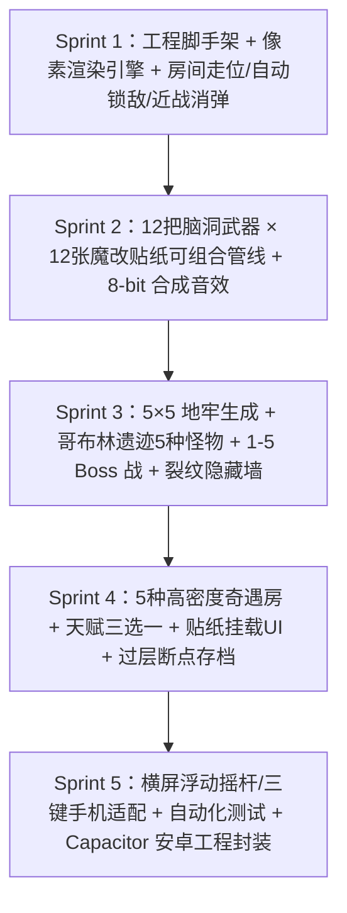

# 《魔改骑士（Mod Knight）》M1 垂直切片开工实施计划

## Goal Description

将已定稿的 7 份《魔改骑士》完整游戏设计文档，从零推进为**第一阶段可玩原型（M1 垂直切片）**：
- 先把**最决定一款肉鸽好不好玩的“最小闭环”**做到极高完成度：**横屏极简元气手感（走位 + 自动锁敌 + 破盾保护 + 近战砍弹幕） × 武器贴纸魔改化学反应 × 高密度奇遇房与隐藏裂纹墙 × 完整 1-1~1-5 地牢与关底 Boss 战**。
- 代码架构从第一天起保持**仿真核（`src/sim`）与渲染/输入层完全解耦**，既让 PC 浏览器和安卓手机共享同一套 60fps 核心，也为二期「Wi-Fi 局域网双人联机」和「豪华客厅全功能」打牢地基，避免推倒重构。

---

## 本机开发环境摸底结论

经检查，当前 Windows 开发机工具链状态如下：

| 工具 | 检测状态 | 路径 / 版本 | 对开工的影响 |
| :--- | :---: | :--- | :--- |
| **Node.js / npm** | ✅ 已就绪 | `v24.20.0` | 可**立刻启动** Vite + TypeScript + Vitest 开发与调试 |
| **Git** | ✅ 已就绪 | `v2.56.0` | 可做版本管理与后续云端 CI 自动出 APK |
| **ADB** | ✅ 已就绪 | `C:\Program Files\ADB\platform-tools\adb.exe` | 已有安卓装包工具，APK 生成后可直接 `adb install` 推到手机 |
| **JDK / Android SDK** | ❌ 未安装 | — | 本地暂无法直接跑 Gradle 编译 `.apk`，但不阻塞 M1 游戏开发与手机局域网真机试玩 |

> [!TIP]
> **零等待的真机试玩技巧**：在安装 Android 打包环境前，我们开启 Vite 局域网服务（`npm run dev -- --host`）并内置横屏 PWA 清单，你的安卓手机连同一 Wi-Fi 打开局域网地址即可**直接全屏横屏实测虚拟摇杆、三键触控与战斗手感**，改一行代码手机 1 秒热更新！

---

## User Review Required

> [!IMPORTANT]
> 请在点击 **Proceed（批准开工）** 前确认以下 3 项关键决策：
>
> 1. **项目代码目录位置**：拟在你的设计文档同级目录下新建工程 `E:\Gemini_file\01_Projects_项目工作区\魔改骑士_地牢游戏设计\mod-knight\`（符合你的 `E:\Gemini_file` 存放规范，开发时也可直接将该目录设为 Antigravity 活动工作区）。
> 2. **M1 首版交付范围（先好玩，再铺量）**：
>    - **英雄与宠物**：2 位首发英雄（**铁桶骑士** + 原创招牌**贴纸工匠**）+ 1 只宠物（**橘猫「大橘」**）+ 极简快捷选人出发厅；
>    - **脑洞武器（12 把）**：超级咸鱼、高压电蚊拍、折凳、破旧魔导手枪、地精转轮加特林、像素霰弹大喷子、中世纪迫击炮、钞能力散钱枪、雷电法王权杖、尖叫橡胶鸡、像素外卖保温箱、Boss 红武「哥布林祭司的图腾柱」；
>    - **魔改贴纸（12 张）**：自动拐弯、一分三分裂、激光化改装、弹弹乐碰碰、超级巨化、爆裂辣椒、零下百度、十万伏特、鬼畜射速、节能环保、下蛋母鸡、混沌随机；
>    - **关卡与奇遇**：完整 `1-1 ~ 1-5` 哥布林遗迹（5 种哥布林怪物 + 精英变体 + 爆裂油桶/木箱/石柱 + 隐藏裂纹密室 + 1-5 Boss「哥布林大祭司」）+ **5 种奇遇房**（贴纸工坊、命运老虎机、可抢劫黑心奸商、恶魔诅咒祭坛、神奇许愿池）+ 8 项核心局内天赋 + 过层断点存档。
> 3. **安卓 APK 打包路线选择**（M1 主体跑通后执行，二选一）：
>    - **方案 A（推荐，省空间）**：接入 Capacitor Android 工程 + **GitHub Actions 云端自动构建 APK**，无需在本机折腾 10GB Android Studio；
>    - **方案 B（全本地离线）**：本机轻量安装 **JDK 17 + Android Command-line Tools（约 500MB）**，本地编译 `app-debug.apk` 并用你现成的 `adb` 一键装手机。

---

## Open Questions

> [!NOTE]
> 以下问题若你没有特殊偏好，我将按括号内的默认值直接推进：
> - **APK 打包偏好**：选择方案 A（云端自动出包）还是方案 B（本地轻量命令行出包）？（默认：先完成 M1 浏览器 + 手机局域网真机畅玩，同步生成 Capacitor 工程与 GitHub Actions 构建脚本，之后再按你的偏好落 APK）
> - **是否将本实施计划同步备份一份到项目文件夹** `E:\Gemini_file\01_Projects_项目工作区\魔改骑士_地牢游戏设计\07_M1启动实施计划.md`？（默认：批准后开工时顺手同步保存）

---

## Proposed Changes

项目工程全部创建于 `E:\Gemini_file\01_Projects_项目工作区\魔改骑士_地牢游戏设计\mod-knight\`，严格按 **6 层依赖从底向上** 搭建：



---

### Layer 0：工程脚手架与构建测试基建

初始化轻量、零冗余的 TypeScript + Vite + Vitest 工程，同时支持 PC 浏览器开发、手机局域网全屏 PWA 试玩与 Capacitor 打包。

#### [NEW] [package.json](file:///E:/Gemini_file/01_Projects_项目工作区/魔改骑士_地牢游戏设计/mod-knight/package.json)
- 依赖仅保持极简：`vite`、`typescript`、`vitest`（后续加 `@capacitor/core`、`@capacitor/cli`、`@capacitor/android`）。
- 脚本：`dev`（支持 `--host` 手机局域网直连）、`build`、`test`、`typecheck`。

#### [NEW] [vite.config.ts](file:///E:/Gemini_file/01_Projects_项目工作区/魔改骑士_地牢游戏设计/mod-knight/vite.config.ts)
- 配置相对路径 `base: './'`（Capacitor 离线加载必需）与 Vitest 测试环境。

#### [NEW] [index.html](file:///E:/Gemini_file/01_Projects_项目工作区/魔改骑士_地牢游戏设计/mod-knight/index.html)
- 配置移动端 `viewport-fit=cover`、`user-scalable=no`、禁止长按选字/下拉刷新，并挂载全屏横屏 `manifest.webmanifest`。

---

### Layer 1：权威仿真核与联机解耦基座（`src/sim/`）

完全不引入任何 `window` / `document` / `Canvas` API，纯 TypeScript 驱动 60Hz 固定步长仿真。

#### [NEW] [src/sim/types.ts](file:///E:/Gemini_file/01_Projects_项目工作区/魔改骑士_地牢游戏设计/mod-knight/src/sim/types.ts)
- 定义联机友好的核心契约：`PlayerId`、`InputCommand`、`WorldState`、`PlayerState`、`WeaponInstance`、`Projectile`、`Enemy`、`Room`、`EventFeed`（向渲染/音效层抛出粒子、闪白、震屏、音效事件）。

#### [NEW] [src/sim/rng.ts](file:///E:/Gemini_file/01_Projects_项目工作区/魔改骑士_地牢游戏设计/mod-knight/src/sim/rng.ts)
- 实现确定性伪随机数生成器（Mulberry32 `SeededRNG`），支持地牢生成、老虎机、暴击与贴纸随机抽取的可复现性。

#### [NEW] [src/sim/world.ts](file:///E:/Gemini_file/01_Projects_项目工作区/魔改骑士_地牢游戏设计/mod-knight/src/sim/world.ts)
- 核心 `GameWorld.step(commands, dt)`：
  - 玩家移动、墙体/掩体滑动碰撞；
  - 铁三角机制：**护盾 3.5 秒脱战自动回盾 + 破盾不穿伤保护 + 能量球拾取**；
  - 英雄主动技能执行（铁桶骑士【双持狂热】、贴纸工匠【万能胶炮台继承当前主武器贴纸】）；
  - 橘猫「大橘」AI（咬怪拉仇恨、每清 3 房刨金币、被打休眠 4 秒复活）。

#### [NEW] [src/sim/targeting.ts](file:///E:/Gemini_file/01_Projects_项目工作区/魔改骑士_地牢游戏设计/mod-knight/src/sim/targeting.ts)
- 实现手机端最关键的**自动锁敌算法**（11 格视线检测 + 15% 目标黏性防抽搐 + 无敌时对齐移动方向 + 1.3 格贴脸优先手刀消弹）。

---

### Layer 2：武器 × 魔改贴纸可组合管线（`src/content/` & `src/sim/combat/`）

本作最大爽点的核心引擎：通过统一的 `AttackContext` 管线让任意武器和任意贴纸产生离谱但稳定的化学反应。

```typescript
// 核心设计：近战武器贴上弹道类贴纸时，保留砍子弹能力并额外射出剑气/激光/追踪弹
export interface AttackContext {
  ownerId: string;
  weaponId: string;
  stickers: StickerId[];
  damage: number;
  manaCost: number;
  critChance: number;
  critMult: number;
  projectileCount: number;
  spreadRad: number;
  scale: number;
  speed: number;
  mode: 'melee' | 'bullet' | 'laser' | 'lob';
  homingStrength: number;
  bounces: number;
  elements: Set<'fire' | 'ice' | 'lightning'>;
  spawnChickenEveryN: number;
  isShadowClone?: boolean;
}
```

#### [NEW] [src/content/weapons.ts](file:///E:/Gemini_file/01_Projects_项目工作区/魔改骑士_地牢游戏设计/mod-knight/src/content/weapons.ts)
- M1 首批 12 把高辨识度脑洞武器数据表与专属钩子（咸鱼冰冻、高压电蚊拍砍弹触发连锁闪电、折凳贴纸加成 +20%、钞能力散钱枪扣金币、尖叫鸡震碎弹幕、哥布林图腾柱砸地+陨石雨等）。

#### [NEW] [src/content/stickers.ts](file:///E:/Gemini_file/01_Projects_项目工作区/魔改骑士_地牢游戏设计/mod-knight/src/content/stickers.ts)
- M1 首批 12 张核心魔改贴纸钩子实现（`onBuildContext` / `onHit` / `onKill`），包含【混沌随机贴】每发白嫖 2 种其他贴纸的防递归处理。

#### [NEW] [src/sim/combat/attackPipeline.ts](file:///E:/Gemini_file/01_Projects_项目工作区/魔改骑士_地牢游戏设计/mod-knight/src/sim/combat/attackPipeline.ts)
- 武器与贴纸融合发射器、暴击计算、近战弧形消弹判定、同屏 180 发弹幕对象池上限与伤害合并防卡顿保护。

---

### Layer 3：地牢生成、奇遇房、怪物与 1-5 Boss（`src/sim/dungeon/`）

#### [NEW] [src/sim/dungeon/generator.ts](file:///E:/Gemini_file/01_Projects_项目工作区/魔改骑士_地牢游戏设计/mod-knight/src/sim/dungeon/generator.ts)
- 在 `5×5` 房间网格生成主路与分支（出生房、2~4 战斗房、1 宝箱房、1~2 奇遇房、45% 裂纹隐藏密室、传送门/Boss 房），并生成室内石柱、木箱与红色爆裂油桶布局。

#### [NEW] [src/sim/dungeon/curiosities.ts](file:///E:/Gemini_file/01_Projects_项目工作区/魔改骑士_地牢游戏设计/mod-knight/src/sim/dungeon/curiosities.ts)
- 实现 M1 首批 5 大节目效果奇遇房：
  1. **贴纸工坊**：买贴纸 / 刷新 / 35 金无损撕贴转移 / 90 金扩槽；
  2. **命运老虎机**：拉霸 5 档概率结果（含定时炸弹惊喜与 JACKPOT 金币雨）；
  3. **黑心奸商（可抢劫！）**：正常购买 4 件商品，或对其输出超 10 点伤害触发锁门激怒变身双持加特林精英 Boss，打赢白嫖全摊；
  4. **恶魔诅咒祭坛**：扣除生命上限换极品紫/橙贴纸或传说武器；
  5. **神奇许愿池**：10 金许愿出药水/贴纸/翻车怒蛙精英怪。

#### [NEW] [src/sim/dungeon/enemies.ts](file:///E:/Gemini_file/01_Projects_项目工作区/魔改骑士_地牢游戏设计/mod-knight/src/sim/dungeon/enemies.ts)
- 实现哥布林遗迹 5 种小怪（长矛手、吹箭手、投弹手、图腾萨满、巨盾野猪）+ 精英怪加成 + **1-5 关底 Boss「哥布林大祭司」**（三连扇形火球、红圈预警陨石雨、半血召唤可打爆致晕的图腾柱、必掉红武与稀有贴纸）。

---

### Layer 4：复古像素程序化精灵渲染与 WebAudio 8-bit 音效（`src/render/` & `src/audio/`）

#### [NEW] [src/render/pixelSprites.ts](file:///E:/Gemini_file/01_Projects_项目工作区/魔改骑士_地牢游戏设计/mod-knight/src/render/pixelSprites.ts)
- 内置离线像素画布生成器：根据精简像素矩阵 + 调色板自动生成带 `1px` 清晰黑描边的角色、怪物、12 把脑洞武器、贴纸图标、地砖/油桶/宝箱/老虎机精灵缓存，**零外部图片加载失败风险**，且支持后续直接替换为手绘 PNG 精灵表。

#### [NEW] [src/render/canvasRenderer.ts](file:///E:/Gemini_file/01_Projects_项目工作区/魔改骑士_地牢游戏设计/mod-knight/src/render/canvasRenderer.ts)
- `480×270` 逻辑像素画布 + 全面屏自动水平延展（不拉伸、无黑边）、`imageSmoothingEnabled = false`；
- 实现全部 6 项打击感（Game Juice）：受击纯白帧 `60ms`、暴击微顿帧 `30ms`、分级微震屏、弹壳抛射、分层飘字、超 40 发玩家子弹自动半透明保护敌方弹幕可读性。

#### [NEW] [src/audio/sfx.ts](file:///E:/Gemini_file/01_Projects_项目工作区/魔改骑士_地牢游戏设计/mod-knight/src/audio/sfx.ts)
- 纯 WebAudio API 复古 8-bit 音效合成器：枪械射击、激光嗡鸣、咸鱼“啪唧”、橡胶鸡魔性滑音惨叫、近战切子弹金属叮当、老虎机叮铃铃、爆炸低频噪波与清房解锁和弦。

---

### Layer 5：横屏极简触屏 HUD、贴纸面板与断点存档（`src/ui/` & `src/platform/`）

#### [NEW] [src/ui/TouchControls.ts](file:///E:/Gemini_file/01_Projects_项目工作区/魔改骑士_地牢游戏设计/mod-knight/src/ui/TouchControls.ts)
- 左半屏浮动摇杆（防误触 8% 死区）、右手人体工学三键（大圆攻击/互动智能切换、技能冷却环、切枪/长按看贴纸）、兼容 PC 键鼠（`WASD` + 鼠标/`J`/`K`/`Q`/`Tab`）。

#### [NEW] [src/ui/HudOverlay.ts](file:///E:/Gemini_file/01_Projects_项目工作区/魔改骑士_地牢游戏设计/mod-knight/src/ui/HudOverlay.ts)
- 避让挖孔屏安全区的顶部状态栏（HP/护盾/蓝量/金币/层数/小地图/暂停）；
- 轻量「拾取魔改贴纸浮窗」（暂停选择贴主手/副手/分解换金）、「三选一天赋弹窗」、「Boss 血条与台词气泡」、「极简选英雄出发面板」。

#### [NEW] [src/platform/storage.ts](file:///E:/Gemini_file/01_Projects_项目工作区/魔改骑士_地牢游戏设计/mod-knight/src/platform/storage.ts)
- 本地永久蓝币/图鉴计数存档 + 过传送门自动写入 `run_checkpoint.json` 断点续玩（重开网页/App 可直接继续当前层）。

---

### Layer 6：Capacitor 安卓打包准备（`capacitor.config.ts`）

#### [NEW] [capacitor.config.ts](file:///E:/Gemini_file/01_Projects_项目工作区/魔改骑士_地牢游戏设计/mod-knight/capacitor.config.ts)
- 预配 App ID（`com.chuiyi.modknight`）、应用名 `魔改骑士`、`webDir: 'dist'`，并配套一份清晰的一键构建 APK 说明（支持云端 GitHub Actions 或本地轻量命令行打包）。

---

## Verification Plan

### Automated Tests
批准并开发完成后，在 `mod-knight/` 下运行完整自动化验证套件：
1. **静态类型检查**：`npm run typecheck`（`tsc --noEmit` 零报错）。
2. **核心仿真单元测试**：`npm test`（Vitest）：
   - `rng.test.ts`：同种子生成完全一致的地图与老虎机序列；
   - `attackPipeline.test.ts`：验证贴纸叠加（如折凳 +20%、超级咸鱼 + 激光化 + 分裂、节能环保蓝耗保底 0、混沌随机不无限递归、180 发弹幕上限保护）；
   - `combatRules.test.ts`：验证护盾 3.5 秒自动回复、破盾不穿伤保护、近战挥砍摧毁敌方子弹、Boss 控制时间递减；
   - `dungeonGenerator.test.ts`：连续生成 50 次 `1-1 ~ 1-5` 地图，断言所有房间 100% 从出生房连通、宝箱房与奇遇房数量达标、1-5 必含 Boss 房。
3. **生产构建检查**：`npm run build` 验证 `dist/` 静态产物完整打包零错误。

### Manual Verification
1. **PC 浏览器端实测**（由我启动本地开发服务并通过内置浏览器/你直接打开体验）：
   - 选铁桶骑士或贴纸工匠进入 `1-1`，验证自动锁敌、近战砍子弹、打破爆裂油桶炸怪；
   - 拾取贴纸给咸鱼/加特林魔改，验证视觉特效（激光/追踪/巨化/下蛋小鸡）与 8-bit 音效正常触发；
   - 在奇遇房体验老虎机、贴纸工坊撕贴转移、以及**故意攻击黑心奸商触发抢劫 Boss 战**；
   - 炸开裂纹墙进入隐藏密室；
   - 通关 `1-5` 击败哥布林大祭司并拾取红武，刷新页面验证过层断点续玩功能。
2. **安卓手机真机触控实测**（你用手机连同一 Wi-Fi 打开局域网地址，或后续安装 APK）：
   - 横屏状态下验证左手浮动摇杆无卡顿、右手攻击/技能/切枪三键不误触、挖孔屏无遮挡、60fps 流畅运行。
